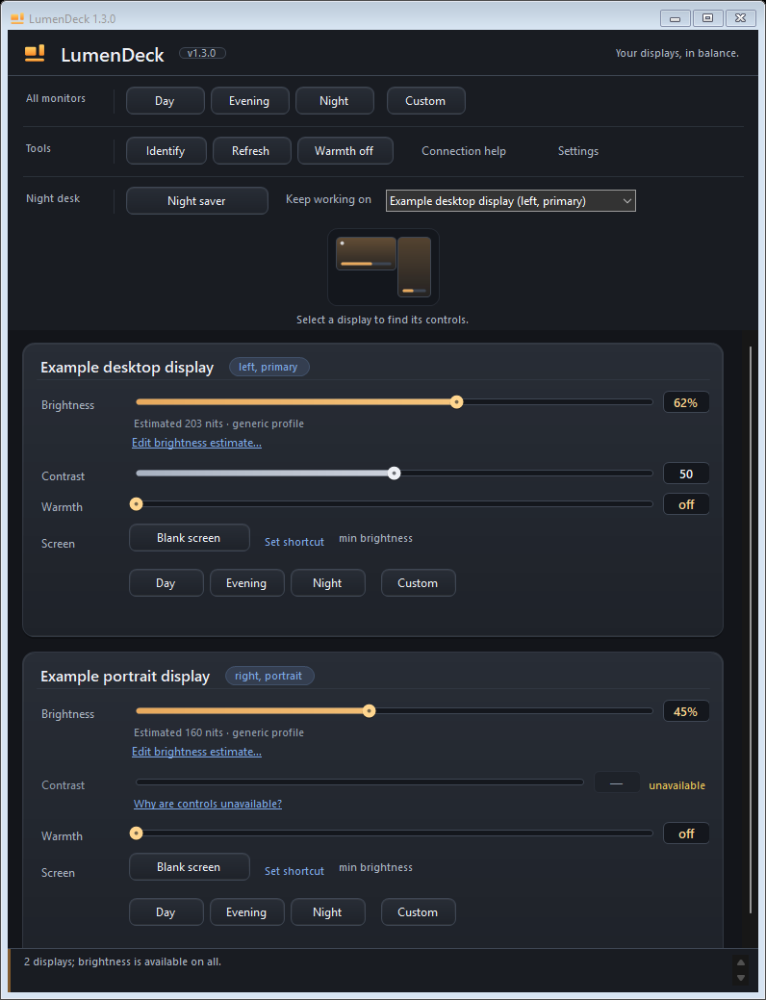

# LumenDeck

**Adjust supported monitors' brightness, contrast and warmth on Windows —
from one window, or one command.**

[](https://github.com/snowyukitty/LumenDeck/actions/workflows/build.yml)
[](LICENSE)
[](#install)
[](#build-from-source)

<br clear="left">

**Start here:** [Download](#install) · [Set up your desk](#your-first-desk-setup) ·
[Troubleshoot](#troubleshooting) · [Contribute](CONTRIBUTING.md)

An external monitor may not have a brightness slider in Windows. Microsoft's
[brightness guide](https://support.microsoft.com/en-us/windows/hardware/display-graphics/change-display-brightness-and-color-in-windows)
points users to the monitor's own buttons when that slider is unavailable.
LumenDeck brings supported monitor controls into one desk-wide interface.

LumenDeck talks to the monitors directly over **DDC/CI**, the control channel
that rides the video cable and drives the same values as the on-screen menu. A
laptop's internal panel can be handled over WMI. Available controls depend on
the display, driver and connection; brightness and contrast are checked separately.

Runs as an ordinary user. No administrator rights, no drivers, no service.

```powershell
lumendeck-cli --list            # every monitor and what it will accept
lumendeck-cli --preset Night    # level the whole desk for the evening
lumendeck-cli -m "left" -b 55 -w 5000
```

<p align="center">
  
</p>

<p align="center"><sub>Actual window rendered from development source <code>ff270ac</code>,
using two fictitious displays; released versions may differ.
<a href="docs/assets/screenshot.json">Render details</a>.<br>
62% and 45% calculate <b>estimated 203 and 160 nits</b> from generic profiles.
The app does not measure light. The portrait fixture has no contrast support.</sub></p>

---

## What it does

| | |
|---|---|
| **Brightness & contrast** | Per monitor, over DDC/CI (`VCP 0x10` / `0x12`) |
| **Colour temperature** | Per monitor, 3000K–6500K, as a blue light filter |
| **Presets targeting estimated luminance** | Day / Evening / Night — choose brightness percentages using panel profiles; edit their targets |
| **Preset schedule** | Optional: request Day, Evening, Night or Custom at times you choose |
| **Custom** | Request your remembered manual levels per monitor; presets preserve those levels |
| **Reversible screen blackout** | Per-monitor black overlay plus minimum supported brightness; click or use an optional global shortcut to restore |
| **Night saver** | Keep one work display on and dim it toward your Night target; darken all other displays with one click, then restore their saved brightness |
| **Precise adjustment** | Click a slider's value or press F2 to enter an exact value; arrows adjust one hardware unit, Shift adjusts ten |
| **Additional advertised controls** | Input source, picture mode, speaker volume, sharpness, RGB gain, black level, factory reset — availability and behavior depend on the monitor |
| **Desk map** | A scale drawing of your actual monitor layout; click a screen to jump to it |
| **Identify** | Puts each monitor's name on its own glass |
| **Laptop panels** | Internal displays via `WmiMonitorBrightnessMethods` |
| **Command line** | Scriptable, with JSON output and meaningful exit codes |
| **Tray app** | Lives in the notification area; optional start-with-Windows |

Desk commands are grouped into **All monitors**, **Display tools** and **Night
desk**. The groups wrap as the window narrows, keeping actions reachable without
forcing a wide window. The work-display label and selector move together.
Short windows automatically hide the desk map to leave room for scrollable
monitor cards; it returns when there is space. Identify remains available.
Monitor cards also wrap long names, screen shortcuts and per-monitor presets
within their available width.
Clicking a display on the desk map aligns its card's adjustment area and focuses
its brightness bar, or warmth when brightness is unavailable. Keyboard adjustment
then applies to that selected display.
The development interface uses layered slate cards, stronger display headings,
quiet help/settings commands and framed amber readouts. Contrast stays neutral,
and the focused card retains an amber edge and marker. **Settings > Use Windows
Mica title bar** optionally adds the Windows 11 title-bar material; the content
stays opaque and older systems keep the slate frame. See the
[interface design notes](docs/ui-design.md).
Moving between monitors with different scaling batches DPI layout to avoid
repeated card measurement and command-bar flickering; see the
[repair and verification notes](docs/cross-display-dpi.md).
If an adjustment fails or cannot be confirmed, its card keeps a notice with
Connection help and Dismiss. Other actions and retries do not erase that history;
dismissing the notice does not confirm the change. Refresh replaces the cards
with the new scan, which also does not establish that an earlier request succeeded.

---

## Designed for a multi-monitor desk

### 1. Presets target estimated luminance

An identical brightness percentage can produce different amounts of light on
different panels. A profile lets presets account for that difference instead
of assigning every monitor the same percentage.

LumenDeck models each panel as `nits ≈ floor + (peak − floor) × pct` and solves
for a percentage targeting estimated luminance. For example, a 400-nit peak and
50-nit floor give approximately 200 nits at 43%; a 250-nit peak and 40-nit floor
give approximately 200 nits at 76%. These are model calculations, not readings.

Panels it has no profile for get a generic estimate, and the UI *says* it is an
estimate rather than presenting a guess as a measurement. Add your own in
`%APPDATA%\LumenDeck\panels.json`. Even measured profile endpoints do not prove
that a panel's entire brightness curve is linear or that two screens look alike.

Cards show **Estimated nits** with **user profile** or **generic profile**. A
profile's `Measured` flag means its author declares peak/floor instrument
measurements; missing flags default to `false`. Calculated nits are still estimates.

Choose **Edit brightness estimate…** on a card to edit peak/floor and sources,
and preview current estimated nits plus preset brightness percentages. Save
updates estimates and future presets without adjusting the screen. Profiles use
the full model name; identical models share a profile. The editor explains when
it starts from a broader match and lets you remove only the full-name entry,
with a preview of the next broader or generic profile. Existing files are backed
up in `%APPDATA%\LumenDeck\profile-backups`. For matching, conflict and backup
details, see [profile editing](docs/profile-editing.md).

A preset requests changes across the desk; **Custom** requests your remembered
manual brightness, contrast and warmth. Manual slider changes update that
monitor's Custom position, while Day / Evening / Night preserve it. Custom is
not an undo history: moving a slider again replaces that monitor's remembered
position. New monitors start with a Custom position from their initial readings.
Changes save in the background; check **Settings** for a waiting or unconfirmed
save. Inspect the screen and any card warnings after requesting a preset or
Custom restoration.

To change presets by time of day, choose **Settings > Preset schedule…** and
turn it on. It requests each period's preset once when the period begins (or
after the first scan when LumenDeck starts during it); moving a slider or
choosing another preset holds until the next scheduled time. It runs only while
LumenDeck is running, and the notification icon shows the current period.

The built-in targets are Day 200 nits / 6500 K, Evening 150 nits / 5600 K and
Night 110 nits / 4600 K. Choose **Settings > Preset targets…** to change them;
the editor previews the brightness percentage each connected display would
receive. Saving changes future preset requests only, in the window, tray and
`lumendeck-cli --preset`; it does not adjust a display or your Custom levels.

### 2. Blue light reduction that works even when the monitor refuses

The obvious way to reduce blue light is the monitor's own RGB gain registers.
**A monitor can advertise those registers and ignore every write to them.** That
was measured here, not assumed: on one of the panels this was built against,
sweeping blue across the full 0–100 range returned an unchanged value thirteen
times in a row while every call reported success. That same panel offers no warm
colour preset at all — only 6500K and *cooler*.

So warmth is applied as a per-display **GPU gamma ramp**, composed on top of
the captured or stored baseline ramp. Turning warmth off requests that baseline
again. This preserves the baseline data rather than replacing it with an identity
ramp; it is not a guarantee of complete ICC, HDR or driver compatibility.
Other colour tools can overwrite the ramp, and unreadable baselines can prevent
reliable restoration. Check the result on your own display.

LumenDeck provides a separate warmth setting for each display.

The Kelvin value is a requested tint using an approximate gamma-2.2 model, not a
measurement of the display's white point. `test\Test-Gamma.ps1` independently
reads the GPU ramp and checks its model-implied tint; it cannot measure emitted
light. Physical colour temperature requires an instrument and depends on the
panel, calibration and rendering pipeline. See [docs/notes.md](docs/notes.md).

### 3. It never asks you to trust a monitor number

`\\.\DISPLAY1`, `2`, `3`… is not a stable identity. The numbering carries gaps
from past hot-plugging, and it need not match the number Windows paints during
*Identify*. Acting on a guessed mapping adjusts the wrong monitor and looks
exactly like success.

LumenDeck labels monitors by **model and physical position**, keys saved settings
on **EDID identity** (falling back to the physical port when two panels are truly
identical), draws your desk to scale, and has its own **Identify**.

---

## Install

This README describes the current source. Check the release notes for the
features included in a downloaded version; changes under **Unreleased** in the
[changelog](CHANGELOG.md) are not yet part of a published download.

Download the attached app files from **[Releases](https://github.com/snowyukitty/LumenDeck/releases)**.
The published [v1.0.0](https://github.com/snowyukitty/LumenDeck/releases/tag/v1.0.0)
offers separate self-contained executables. Its attached release notes describe
that download; the current development source includes additional features
described throughout this README.

### Will it work with my displays?

LumenDeck discovers each control separately. A missing contrast slider does not
mean that brightness or the whole connection failed. These are the current
source's control paths, not a tested-device list or a promise for every panel:

| What you want to change | What it depends on | First check |
|---|---|---|
| External-monitor brightness or contrast | DDC/CI support in the monitor and a connection that passes its commands | Enable DDC/CI in the monitor menu if available. If using a dock, hub or KVM, try a direct video connection. |
| Built-in-panel brightness | A brightness interface exposed by the laptop's Windows driver; LumenDeck uses WMI as a fallback | Try the Windows brightness slider. If it is missing too, check the manufacturer's display-driver guidance. This WMI path does not provide hardware contrast. |
| Per-display warmth | GPU gamma-ramp support; restoration uses a captured or stored baseline | Check the visible result. An unreadable baseline can prevent reliable restoration. HDR, calibration tools and drivers can affect behavior; full ICC/HDR compatibility is not established. |
| Screen blackout / Night saver | A black overlay, with minimum hardware brightness when available | Restore one screen and verify its brightness before relying on a whole-desk setup. Without brightness support, the overlay still works; it does not turn the monitor off. |

Open **Connection help** in a build that includes it for the observed controls
and recovery steps. After changing a cable or monitor setting, choose **Refresh**;
it can also reapply saved warmth and retry active blackout recovery. Start with
[one display](#your-first-desk-setup) before changing the whole desk.

### Choose your download

Two executables:

| | |
|---|---|
| `LumenDeck.exe` | the window and the tray icon |
| `lumendeck-cli.exe` | the command line |

- **Separate EXE assets:** download `LumenDeck.exe` into a folder you want to keep,
  then open it. Download `lumendeck-cli.exe` too if you want command-line controls.
  No extraction or separate .NET runtime is needed.
- **Portable ZIP:** if the release offers an app ZIP, extract the whole archive,
  then open `LumenDeck.exe`. GitHub's automatic **Source code** archives contain
  source files; build those using the instructions below.

The development portable package includes offline **QUICKSTART.txt**, the MIT
licence and **SHA256SUMS.txt**. A separate `.zip.sha256` records the archive hash.
Hashes detect changed files; they do not establish the publisher's identity.
Packages are currently unsigned. Choose **Settings > About LumenDeck** for
version/build and offline help when your build includes that entry.

If Windows Security detects malware or blocks the download, stop and read
[download security](docs/download-security.md). An unsigned-app reputation
prompt and an antivirus detection need different investigation; a matching
checksum does not clear a malware detection.

Settings live separately in `%APPDATA%\LumenDeck`; portable distribution does
not mean settings are saved beside the executable. Exit from the tray menu
before replacing or moving app files so any blanked screens can be restored.
Opening `LumenDeck.exe` or its shortcut again reveals the existing control
window. It keeps one app instance; relaunching does not scan or adjust a monitor.
If startup or different permissions prevent the request, use the existing
notification-area icon and run both copies with normal user permissions.

**Settings** in the window exposes Windows startup, minimised launch, closing to
the notification area and saved-warmth reapplication. The tray's startup switches
stay synchronized. Local preferences save in the background; checks stay at the
active preference until completion, and an unconfirmed save retains it. Local
preference options are temporarily disabled while saving. The Windows startup switch shows registration
readback or an explicit unavailable state. Start minimised affects the next
launch; with keep-running off it starts on the taskbar. Warmth reapplication affects the next display scan and
does not adjust the current screen when toggled. Use tray **Exit** to quit when
keep-running is enabled.
While a settings save is pending, wait for it to settle before using Exit again.
See [preference behavior](docs/preferences.md) for storage and verification details.

The GUI and CLI are separate binaries on purpose: a GUI-subsystem process cannot stream
stdout back to the shell that launched it, so a single executable pretending to
be both prints nothing when piped.

### Your first desk setup

For builds with the controls described here, start with one display before
changing the whole desk:

1. Choose **Identify** and match the physical screen to its card. If a display
   or slider is missing, open **Connection help** before adjusting another card.
2. Note its current brightness, then move that card's brightness slider a small
   amount. Check the screen and card warnings. To return to the earlier value,
   move the slider back; **Custom** now remembers the new manual position.
3. Once your manual levels are comfortable, try a preset on one card. That
   card's **Custom** requests its remembered manual levels. The **All monitors**
   commands apply across the desk, skipping blanked displays.
4. To darken unused screens, select your work display in **Keep working on**,
   then choose **Night saver**. Use **Restore night desk** for those screens;
   screens blanked individually retain their own restore controls. Verify the
   screens after restoration.

Closing the window normally keeps the app in the notification area when
**Keep running when closed or minimised** is enabled. Open the executable again
to reveal it, or use tray **Exit** to quit. Before replacing app files, restore
blanked screens and exit normally.

### Build from source

```powershell
git clone https://github.com/snowyukitty/LumenDeck
cd LumenDeck
dotnet build LumenDeck.slnx -c Release
powershell -File install.ps1        # installs, shortcuts, adds to PATH
```

Needs the [.NET 10 SDK](https://dotnet.microsoft.com/download). `install.ps1
-Uninstall` removes the installed executables and integration entries.

The installer refuses to install or uninstall while LumenDeck is running. Exit
through the tray menu first. Uninstall preserves settings and unrelated files
in the app directory.

To build a verified portable ZIP locally:

```powershell
powershell -NoProfile -File scripts\build-release.ps1
```

Each run preserves earlier builds and prints the new ZIP path under `dist/`.
See [packaging verification](docs/packaging.md) for checks and limitations.

---

## Command line

```
--list                  Every monitor and its current settings
--json                  Machine-readable output
--features              Extra controls each monitor advertises
--diagnose              Observed capabilities and response details
--support-report        Minimal support details with names and IDs excluded

-m, --monitor <text>    Only monitors whose name, position or device matches
-p, --preset <name>     Day | Evening | Night | Custom
-b, --brightness <n>    0-100, or a relative step: +10, -10
-c, --contrast <n>      0-100, or a relative step: +10, -10
-w, --warmth <kelvin>   3000-6500, or "off"
-v, --version           Version
```

Exit codes: `0` done, `1` invalid request or nothing matched, `2` a monitor change
or settings save was unsuccessful (also used for withdrawn `--power`), and `3`
an unexpected command failure — so
it can be used in a scheduled task or bound to a hotkey by whatever launcher you
already use.

The complete request is checked before settings or display access. Unknown,
missing or duplicate options, invalid presets, absolute percentages outside
0–100 and warmth outside 3000–6500 fail before any earlier adjustment is sent.
Use one information command at a time and keep it separate from adjustments;
`--json` belongs with `--list` or `--support-report`. Multiple adjustment options
can be combined. Signed brightness/contrast steps such as `+10` or `-10` still
stop at the display's limits. Valid requests can encounter hardware or storage
failures after execution starts; validation does not make monitor writes atomic.
If the GPU rejects a warmth request, the CLI returns `2` and reports `Requested`
instead of `Applied`. It keeps the previous current/saved warmth and Custom
temperature. Other accepted adjustments in the same command may already have run.

Every monitor card also has **Blank screen** / **Restore screen** and
**Set shortcut**. Blank screen draws a borderless black window over that one
display and lowers it to its minimum supported brightness. Click the black
screen, press a key while it has focus, use the global shortcut, or exit
LumenDeck to request restoration of the exact saved brightness. An interrupted
blackout is retried automatically on the next launch; unavailable displays
retain recovery data. Verify the screen after restoration.

This is deliberately not MCCS hardware-off. Some monitor firmware switches off
the DDC receiver while processing `VCP D6=04`, making the matching wake command
impossible and requiring a physical power button or power-cable reconnect.
LumenDeck therefore never exposes DDC-off through its window, shortcuts, generic
controls, or CLI. On an LCD, a black image cannot save as much power as a true
backlight-off state; reversibility takes priority. A display without software
brightness control still gets the black overlay.

### One-click night desk

Choose your centre display in **Keep working on** (the Windows primary display
is selected by default), then press **Night saver** in the window or tray menu.
The selected display stays on but is dimmed toward your **Night** preset's
estimated target, only if it is brighter; edit that target in **Settings >
Preset targets…**. Other screens get a black overlay and their lowest supported
hardware brightness. **Restore night desk** attempts to restore the saved
hardware brightness values, including the work display's and values on panels
with ranges such as 0–255. Screens you had already blanked individually stay
under their own restore controls. The work display's original brightness is
saved before it is dimmed, so exiting, or the next launch after a crash, puts it back.
If you change the work display's brightness during the night (slider, preset,
Custom or the schedule), your choice wins and ending the night leaves it alone.

You can restore one screen by clicking its black overlay or using its existing
shortcut. Refresh keeps remaining blackouts in place; exiting attempts restoration.
An unavailable display retains its recovery data for the next reconnect or
launch. Displays attached after entering Night saver are left visible so a
new work screen is never unexpectedly hidden. Presets skip blanked displays,
and their brightness slider is disabled until restored.

This reduces light and can reduce backlight power; actual energy savings depend
on the panel. A black LCD still has its backlight on. LumenDeck does not claim
a measured watt reduction or use a hardware-off command that may prevent wake.

### Keyboard commands

Press **F1** in the main window, or choose **Settings > Keyboard controls…**,
for the offline reference. In that guide, Page Up / Page Down scroll and
Home / End go to the start / end; **Escape** closes it.

In the main window, **Ctrl + Page Down / Page Up** selects the next / previous
display card in layout order, wrapping at either end. Selection keeps the same
available control, otherwise brightness or warmth, and scrolls into view.
From the toolbar, next enters the first card and previous the last. These keys
move selection without adjusting a display; navigation pauses during reading.

Slider adjustment keys and F2 / Enter do not act while **Ctrl** or **Alt** is
held. This keeps command combinations from accidentally changing a display or
opening an exact-entry draft. Ordinary keys and Shift adjustments still work.

Focused command buttons activate with **Space** or **Enter**. Moving focus away
before releasing cancels that press; disabled buttons remain unavailable.

Refresh preserves selection on the same display/control when its card is
replaced. A new selection during reading takes priority; a removed display or
unavailable control returns selection to Refresh. The selected card control is
scrolled into view, including in a short window.

### Exact slider values

Click a slider's number, or focus it and press **F2** or **Enter**, to type an
exact value. The dialog shows the display/control, unit and valid range in its
body. Apply sends a request; Cancel or Escape leaves that entry unapplied.
Refresh replacing the card or disabling its control cancels the open entry.

Brightness and contrast use the hardware's reported range;
brightness's usual readout remains a normalized percentage. Warmth accepts
Kelvin directly (3000–6500; 6500 restores the neutral profile).

Arrow keys and wheel notches move brightness or contrast by one hardware unit.
**Shift** multiplies the step by ten; warmth uses 50 K steps. **Home / End** go
to the range limits, and **Page Up / Page Down** make larger adjustments.

```powershell
# dim everything a notch
lumendeck-cli --brightness -10

# warm only the screen on the left
lumendeck-cli -m left --warmth 4600

# -m narrows what is shown, too
lumendeck-cli --list -m left

# and back to your own levels on every screen
lumendeck-cli --preset Custom

# feed it to something else
lumendeck-cli --list --json | ConvertFrom-Json
```

In `--list --json`, `estimatedNits` is a model result (or `null` when brightness
is unavailable) and `nitsAreEstimated` is always `true`. `luminanceProfile` is
`user` or `generic`; `profileEndpointsMeasured` preserves the user-declared
endpoint flag, not verification of current light output. Earlier versions could
report `nitsAreEstimated: false` simply because a user profile matched. Consumers
that relied on that meaning should use `luminanceProfile` for profile selection.
Strict JSON consumers must also allow the two new metadata fields.

---

## Choosing a monitor tool

These are documented workflows, not an exhaustive feature or compatibility
matrix. Alternative projects' documentation was checked on 2026-10-08; follow
the linked sources for current features and requirements.

| Tool | Documented workflow |
|---|---|
| LumenDeck | Desk map, per-display warmth, estimated-luminance presets, reversible blackout and a standalone JSON-capable CLI. Hardware controls depend on the display and connection. Built-in time scheduling is not provided. |
| [Twinkle Tray](https://github.com/xanderfrangos/twinkle-tray#features) | Its own system-tray brightness flyout, hotkeys, scheduled or idle brightness changes and DDC/CI controls including contrast. Its [command-line options](https://github.com/xanderfrangos/twinkle-tray#command-line-arguments) also include VCP writes and require the app to be running. |
| [Monitorian](https://github.com/emoacht/Monitorian#readme) | Brightness control for multiple monitors. Its [Store add-ons](https://github.com/emoacht/Monitorian#add-on-features) include hotkeys and command-line brightness/contrast controls on a subscription basis. |

---

## Troubleshooting

**A monitor is missing, or its sliders are greyed out.**
Open **Connection help** in the window, or **Why are controls unavailable?** on
the monitor card, for offline checks. When no cards appear, the window distinguishes
reading, a completed scan with no displays and a failed scan. Its state card offers
Connection help and manual Refresh; adjustments wait until current cards are
available. Refresh may reapply saved warmth and recover active blackouts.

The offline guide shows which hardware controls responded,
separates external-monitor checks from built-in-panel guidance, and offers
next steps when no displays were found. A missing contrast control does not
mean that brightness or the whole DDC connection failed.

For the running version and build, choose **Settings > About LumenDeck >
Copy version** and paste the two lines into your issue. This explicit action
copies only the GUI version/build, without display or device details.
If your download has no About entry, use `lumendeck-cli --version` or name the
release you downloaded. If it has no support-report command or preview, describe
the issue and leave that optional field blank; raw diagnostics are not required.

The published `v1.0.0` download has inconsistent embedded version labels:
the GUI reports `1.1.0`, while the CLI reports `1.0.0`. If you use that download,
include the release tag and the reported version when opening an issue. Current
builds use one shared version and verify both executables before packaging.

For an issue, choose **View support report** in Connection help and review the
exact preview before pressing **Copy report**. The CLI equivalent is
`lumendeck-cli --support-report` (or add `--json`). It includes version, observed
control availability and raw ranges, while excluding names, serials, device
identifiers, paths and raw logs. Nothing is uploaded. Counts and ranges still
describe your setup; this is not a guarantee of anonymity.

The CLI report command performs a fresh read-only scan, without loading or
saving gamma-baseline records or adjusting display settings. Use it alone or
with `--json`; mixing it with adjustments or a monitor filter is rejected.
A completed scan, including zero displays, exits `0`; invalid combinations exit
`1`, and a failed scan exits `2` with a report whose scan state is `failed`.
The GUI preview uses the most recent app scan and performs no new hardware I/O.

Advanced `lumendeck-cli --diagnose` includes device identifiers and raw details;
review and redact it before sharing. Common things to check:

1. Check whether DDC/CI is enabled in the monitor's own menu; consult its manual.
2. Try a direct connection if you use a dock, hub or KVM. Connection paths can
   affect DDC access; an unavailable control alone does not establish the cause.
3. For a built-in laptop display, check OEM/driver brightness support. Its WMI
   brightness path is separate from external-monitor DDC/CI.

**Brightness changes, but nothing else does.** Controls can be independently
unsupported, blocked or ignored. `--features` shows advertised capabilities,
which do not prove that a write took effect. This symptom can also be an app
or driver bug. Check the monitor's menu and report the requested action, observed
result and support report rather than assuming a firmware cause.

**The warmth reverts after a reboot.** GPU gamma ramps can reset after a reboot,
display mode change, driver restart or game transition. In **Settings**, enable
**Reapply saved warmth after a display scan** to request saved warmth on startup
and subsequent scans. **Start with Windows** independently requests launch at
sign-in; it does not enable warmth reapplication. Changing either switch does
not adjust the current screen. Check for a failure notice and verify the screen
after the next launch or scan. See [preference behavior](docs/preferences.md).

**Windows still shows the old icon.** Confirm that the shortcut points to the
new executable first. A stale shell icon cache is another possible cause.

---

## Configuration

`%APPDATA%\LumenDeck\`

| File | |
|---|---|
| `settings.json` | colour temperature and your Custom levels per monitor, keyed on EDID identity |
| `panels.json` | your own panel luminance profiles; an example is written on first run |
| `gamma-baselines.json` | saved baseline ramps and applied signatures used for warmth restoration — see below |
| `error.log` | only if something throws |
| `diag.log` | only when `LUMENDECK_DIAG=1` |

Settings saves preserve a file changed by another writer instead of replacing
it with an older whole-document copy. On a conflict, quit and reopen LumenDeck
before saving again; on a busy writer, retry once it finishes. If a file could
not be loaded, the app uses session defaults and preserves the original.
Preferences and new blackouts cannot be confirmed saved in that state.
See [settings storage and recovery](docs/settings-storage.md) before repairing
or resetting a file that may contain blackout recovery records.

`gamma-baselines.json` is the one file worth understanding. A GPU gamma ramp
outlives the process that set it, so an app that simply reads the ramp at
startup cannot tell your display's own state from the warmth it left there
yesterday — and one that gets this wrong composes warmth onto warmth until
"Warmth off" no longer means anything. LumenDeck stores the untouched ramp plus a
signature of what it last wrote to recognise matching ramps. Back up this file
before changing it: deleting it can lose a calibration baseline that cannot be
reconstructed from a tinted ramp. Shape-based fallback helps with simple ramps
but cannot guarantee recovery of an arbitrary calibration.

Set `LUMENDECK_ANONYMISE=1` to replace monitor names with `Display A`, `B`, `C`
in the window, in `--list` and in `--diagnose`. This hides friendly names only;
raw diagnostics still contain device identifiers and other details. Review any
screenshot or diagnostic before sharing, or use the minimal support report.
The luminance profiles still match on the real name.

---

## Design notes

The design combines reversible controls with careful monitor I/O.
[docs/notes.md](docs/notes.md) covers
a physical monitor handle that is legitimately `0`, why `SetVCPFeature` returning
success proves nothing, why working set is the wrong instrument for finding a
leak, why colour temperature has to compose rather than overwrite, how a setting
with no way to set it went straight to a stack overflow, and how two version
numbers agreed with each other while both came from the wrong place.

Contributions welcome — see [CONTRIBUTING.md](CONTRIBUTING.md). Panel profiles
with sources and measurement conditions are especially useful. For code changes,
start with the [architecture and extension map](docs/architecture.md), then follow
the focused verification route for the behavior you change.

The [current milestone checkpoint](docs/checkpoint.md) records implementation scope,
verification and the remaining real-monitor acceptance work before a release.

---

<sub>Keywords: Windows monitor brightness control, external display brightness,
DDC/CI, MCCS, VCP, multi-monitor brightness, per-monitor colour temperature,
blue light filter, night mode, contrast control, monitor input source switching,
KVM, tray app, command line, C#, .NET, WinForms, f.lux alternative, Twinkle Tray
alternative, Monitorian alternative, Windows 10, Windows 11.</sub>

## Licence

MIT. See [LICENSE](LICENSE).
