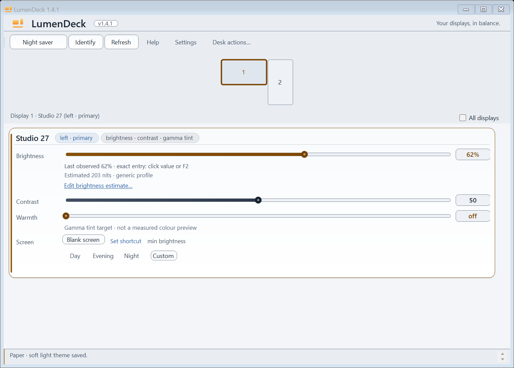
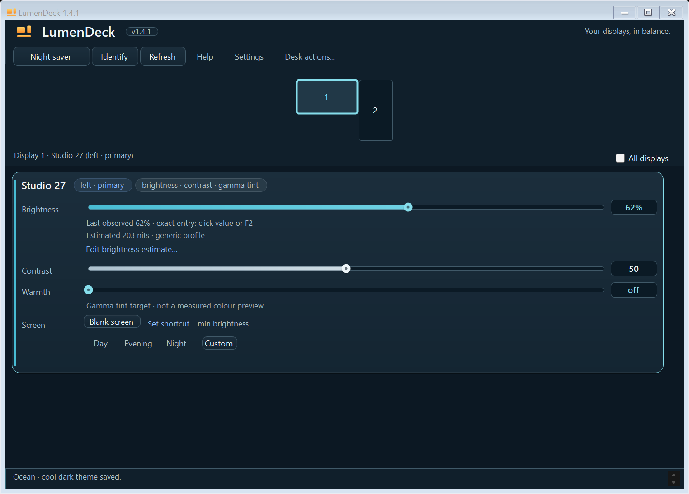
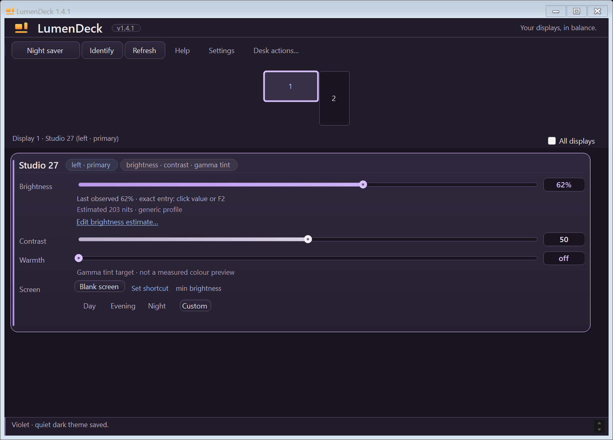

# App appearance

The default material interface uses **Settings > Appearance** for Smoke, Frost
and Ceramic. Smoke and Frost offer Mica, Glass and Solid; Ceramic is opaque.
See the [functional interface guide](material-interface.md) for behavior, saved
preferences and fallback limits.

| Finish | Opaque reference render |
| --- | --- |
| Smoke | [Open](assets/material-smoke.png) |
| Frost | [Open](assets/material-frost.png) |
| Ceramic | [Open](assets/material-ceramic.png) |

These reference renders use synthetic displays and do not capture DWM blur.
Their [source receipt](assets/material-reference.json) is generated by
`scripts/capture-material.ps1`.

## Classic panel themes

Choose **Settings > Theme**. Amber is the original default; the selected item has
one check. Switching updates the existing interface after the settings write is
confirmed. It does not restart the app, rescan displays, change brightness or
warmth, or end Night saver. Your selected display, scroll position and editor
drafts stay in place.

| Theme | Appearance | Native preview |
| --- | --- | --- |
| Amber | Charcoal surfaces with warm amber controls | [Open](assets/screenshot.png) |
| Paper | Soft white surfaces with dark amber controls | [Open](assets/theme-paper.png) |
| Ocean | Deep blue surfaces with cyan controls | [Open](assets/theme-ocean.png) |
| Violet | Muted purple surfaces with lavender controls | [Open](assets/theme-violet.png) |

<table>
<tr><td></td><td></td></tr>
<tr><td></td><td></td></tr>
</table>

These are actual control renders using fictitious displays at native DPI, not
photographs or evidence of DWM-composited material. The [capture receipt](assets/screenshot.json)
records source, assembly and image hashes. See [showcase](showcase.md) to repeat.

## Saving and accessibility

The choice is stored as `ThemeId` in the shared settings file. A missing or
unrecognized ID displays Amber; an unrecognized value is preserved until an
explicit new choice. Failed saves retain the previous live palette and check.
Pending saves disable competing theme choices. Source conflicts and unreadable
settings use the existing recovery guidance; changing appearance cannot bypass
storage protections.

Windows high contrast takes priority. A theme selected while it is active is
saved for use after high contrast is turned off. System setting/colour messages
refresh existing controls without reloading them. Ordinary Windows light/dark
preferences do not override the explicit app choice.

Fonts, spacing, map geometry and control sizes stay identical across themes.
Warnings retain text as well as colour. Native window frames, scrollbars and
selectors follow light/dark intent where Windows supports it; optional Mica
remains a separate preference. Blackout overlays stay black, and temporary
Identify labels keep their fixed high-visibility treatment. System message boxes
and native disabled-control details remain Windows-owned.

## Implementation contract

`Theme` owns immutable named palette records, semantic colour getters and
UI-thread-only bindings. `Theme.Colors` stores getters rather than resolved
colours, including dynamic warning roles. Each subscription is removed when its
component is disposed. Never infer a role from an existing RGB value: high
contrast deliberately maps many different roles to the same system colour.

Custom-painted controls invalidate on change. MonitorCard includes the theme
revision in its one-surface cache key and disposes the previous bitmap. Shared
fonts are retained. A theme change never rebuilds the monitor/controller graph.
New control constructors and state changes must use semantic bindings instead
of copying a palette colour once.

WindowChrome re-evaluates existing handles and handles created later. Light and
high-contrast modes remove the previous dark native-control association with
null parameters, as documented by [Microsoft SetWindowTheme](https://learn.microsoft.com/en-us/windows/win32/api/uxtheme/nf-uxtheme-setwindowtheme).
Only setting/colour notifications trigger the global refresh: SetWindowTheme
itself emits WM_THEMECHANGED, so listening to that message would create a loop.

## Verification

Run `dotnet run --project test/AppTests/AppTests.csproj -c Release -- --themes-only`
for focused checks. An optional second argument writes private synthetic previews.
The full AppTests suite includes these checks and native theme showcase checks.

Coverage includes normal text at 4.5:1 on its semantic surfaces, primary labels
across normal/hover/pressed states, focus indication at 3:1, live draft/selection
retention, unchanged card geometry and objects, surface cache refresh, native
frame intent, saved startup, failure/pending-write behavior, subscription cleanup,
Windows message handling and active Night saver recovery preservation.
Fixtures do not establish physical display darkness, real Windows contrast-theme
switching, foreground interaction or screen-reader speech acceptance.
